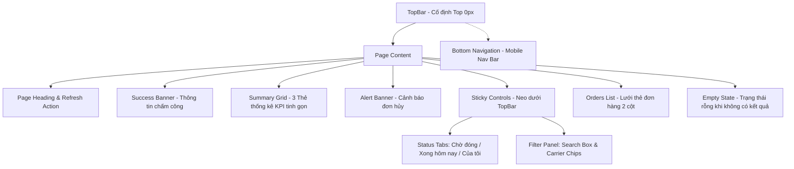

# TÀI LIỆU ĐẶC TẢ GIAO DIỆN & KỸ THUẬT (UI/UX SPECIFICATION)
## Phân hệ: Trung tâm Xử lý & Đóng đơn Kho vận (Fulfillment Dashboard)
**Dự án:** Shopnest Logistics  
**Tài liệu:** `SPEC_DONG_DON.md`  
**Phiên bản:** 1.2  
**Ngày cập nhật:** 19/10/2026  
**Trạng thái:** Đã nghiệm thu & tối ưu  

---

## 1. TỔNG QUAN & MỤC TIÊU HỆ THỐNG

### 1.1. Mục đích
Giao diện **Trung tâm đóng đơn (Packing & Fulfillment)** được thiết kế dành riêng cho nhân viên vận hành kho (Packer / Warehouse Operator) nhằm:
- Theo dõi tức thời số lượng đơn hàng cần đóng, đơn đã hoàn thành và các cảnh báo phát sinh (đơn hủy, đơn trễ hạn).
- Thao tác nhanh chóng: tìm kiếm, lọc theo hãng vận chuyển, nhận đơn đóng (`Bắt đầu đóng`), tiếp tục đóng hoặc hỗ trợ đồng nghiệp (`Cùng đóng`).
- Tối ưu hóa không gian hiển thị (High Information Density) trên cả màn hình máy tính bàn, máy tính bảng và thiết bị cầm tay chuyên dụng (PDA/Mobile).

### 1.2. Nguyên tắc Thiết kế (Design Principles)
1. **Vertical Space Efficiency (Tiết kiệm diện tích dọc):** Đưa vùng làm việc chính (Tabs, Bộ lọc, Danh sách đơn) lên cao nhất có thể, tránh lãng phí không gian cho các khối thông tin tĩnh.
2. **Sticky Control Flow (Cố định điều khiển):** Tabs trạng thái và bộ lọc tìm kiếm luôn bám dính khi cuộn (`position: sticky`), cho phép nhân viên lọc và tìm đơn bất cứ lúc nào mà không cần cuộn ngược lên đầu trang.
3. **Color Coding Nhận diện Hãng vận chuyển:** Chuẩn hóa màu sắc thương hiệu của từng đơn vị vận chuyển theo quy chuẩn:
   - **VTP (Viettel Post):** Đỏ đặc trưng (`#3d1616` / `#ff6e6e` / `#ff8585`).
   - **GHTK (Giao Hàng Tiết Kiệm):** Xanh lục đặc trưng (`#153c21` / `#65df91`).
   - **SPX (Shopee Xpress):** Cam vàng đặc trưng (`#3a2c17` / `#f4c36b`).
   - **Bookship / Gửi xe:** Tím xanh đặc trưng (`#28204e` / `#b6aaff`).
4. **Dark Mode Logistics:** Giảm mỏi mắt trong môi trường làm việc kho đèn LED/ban đêm, sử dụng độ tương phản cao đạt chuẩn WCAG AAA.

---

## 2. KIẾN TRÚC GIAO DIỆN & PHÂN CẤP KHỐI (LAYOUT HIERARCHY)



---

## 3. ĐẶC TẢ CHI TIẾT CÁC THÀNH PHẦN

### 3.1. Khối Thẻ Thống Kê KPI Tinh Gọn (`.summary-grid`)

#### 3.1.1. Mục tiêu tối ưu
Khắc phục nhược điểm của phiên bản cũ (chiếm ~120px–150px chiều cao do xếp dọc 4 dòng icon, tiêu đề, số lượng và trạng thái). Phiên bản mới giảm **55% chiều cao**, chỉ còn **~50px trên Desktop** và **~54px trên Mobile**.

#### 3.1.2. Cấu trúc HTML
```html
<section class="summary-grid">
  <!-- Thẻ 1: Đơn cần xử lý -->
  <article class="summary-card">
    <span class="summary-icon blue">▤</span>
    <div class="summary-texts">
      <span class="muted">Đơn cần xử lý</span>
      <small>Đang chờ đóng</small>
    </div>
    <strong class="summary-num" id="pending-total">06</strong>
  </article>

  <!-- Thẻ 2: Đã hoàn thành -->
  <article class="summary-card">
    <span class="summary-icon green">✓</span>
    <div class="summary-texts">
      <span class="muted">Đã hoàn thành <span class="desktop-only">hôm nay</span></span>
      <small class="positive">Hoạt động tốt</small>
    </div>
    <strong class="summary-num">141</strong>
  </article>

  <!-- Thẻ 3: Đơn cần lưu ý -->
  <article class="summary-card">
    <span class="summary-icon orange">◷</span>
    <div class="summary-texts">
      <span class="muted">Đơn cần lưu ý</span>
      <small class="warning-text">Kho đang xử lý</small>
    </div>
    <strong class="summary-num">26</strong>
  </article>
</section>
```

#### 3.1.3. Đặc tả CSS & Responsive Breakpoints
| Thuộc tính | Desktop (> 700px) | Mobile (≤ 700px) | Extra Small (≤ 370px) |
| :--- | :--- | :--- | :--- |
| **Bố cục thẻ** | `display: grid; grid-template-areas: "icon text num"` | `display: grid; grid-template-areas: "icon num" "text text"` | Giữ nguyên 2 hàng mini |
| **Chiều cao tổng** | **~50px** | **~54px** | **~48px** |
| **Padding** | `10px 14px` | `8px 7px` | `6px 5px` |
| **Kích thước Icon**| `34px × 34px`, bo góc `9px` | `24px × 24px`, bo góc `6px` | `20px × 20px`, bo góc `5px` |
| **Font số liệu** | `22px / 800` | `18px / 800` | `16px / 800` |
| **Xử lý ngắt dòng**| Hiển thị đầy đủ cả chữ `hôm nay` | Ẩn `.desktop-only` tránh rớt chữ | Ẩn `.desktop-only` |

---

### 3.2. Khối Điều Khiển Dính (`.sticky-controls`)

#### 3.2.1. Hành vi Sticky
- **Vị trí cố định:** 
  - Desktop: `top: 68px;` (sát chân thanh Header).
  - Mobile: `top: 58px;` (khớp với Header co nhỏ trên điện thoại).
- **Thứ tự lớp (`z-index`):** Cấp `z-index: 2` (nằm trên danh sách đơn `z-index: 0` và nằm dưới thanh Topbar `z-index: 3`).
- **Nền & Bóng nổi:** Sử dụng màu nền đồng nhất với App Shell `var(--bg)` (`#111419`) kết hợp dải viền mỏng `rgba(255,255,255,0.06)` và `box-shadow: 0 12px 24px -10px rgba(0, 0, 0, 0.6)` để tạo phân lớp thị giác nổi bật khi danh sách đơn hàng cuộn lướt bên dưới.
- **Che mép ngang:** Tận dụng margin âm bù padding (`margin: 0 -14px; padding: 8px 14px;`) giúp dải sticky che phủ 100% chiều ngang màn hình mà nội dung bên trong vẫn gióng thẳng hàng với danh sách đơn.

#### 3.2.2. Hệ thống Tabs trạng thái
- **Tab Chờ đóng (`waiting`):** Lọc tất cả các đơn hàng chưa hoàn thành (`state !== 'done'`).
- **Tab Xong hôm nay (`done`):** Lọc các đơn đã đóng gói xong trong ca (`state === 'done'`).
- **Tab Đơn của tôi (`mine`):** Lọc các đơn đang được tài khoản hiện tại phụ trách (`state === 'mine'`).

#### 3.2.3. Bộ lọc Hãng vận chuyển (Carrier Chips) & Màu sắc chuẩn
| Hãng | Mã | Màu nền chip (Active) | Viền chip (Active) | Màu chữ (Active) | Huy hiệu thẻ đơn |
| :--- | :--- | :--- | :--- | :--- | :--- |
| **Tất cả** | `all` | `#292348` | `#7c6ee7` | `#c4b7ff` | Tùy hãng |
| **GHTK** | `ghtk` | `#183a29` | `#3e9e63` | `#8be0a4` | Nền `#153c21`, chữ `#65df91` |
| **Bookship** | `bookship` | `#292348` | `#7c6ee7` | `#c4b7ff` | Nền `#28204e`, chữ `#b6aaff` |
| **SPX** | `spx` | `#3a2c17` | `#d69b39` | `#f2c46f` | Nền `#3a2c17`, chữ `#f4c36b` |
| **VTP** | `vtp` | **`#3d1616`** | **`#e03838`** | **`#ff8585`** | **Nền `#3d1616`, chữ `#ff6e6e`** |

---

### 3.3. Thẻ Đơn Hàng & Luồng Thao Tác (`.order-card`)

#### 3.3.1. Cấu trúc thẻ đơn hàng
Mỗi đơn hàng được biểu diễn qua 4 phân vùng rõ ràng:
1. **Header thẻ:**
   - Mã đơn (in đậm, ví dụ: `ADH008771`)
   - Tên khách hàng (cắt ngắn bằng `text-overflow: ellipsis` nếu quá dài)
   - Badge hãng vận chuyển với màu nhận diện tương ứng.
2. **Metadata:**
   - Số lượng sản phẩm: Ví dụ `5 SP`
   - Thông tin nhặt hàng: `Nhặt 08:35 18-10 · Trang`
   - Cảnh báo trễ (nếu có): Badge đỏ `Trễ {X} ngày`.
3. **Thanh tiến độ (Progress Chips):**
   - Trạng thái người đóng: `Bạn đang đóng` (xanh dương) hoặc `{Tên} đang đóng`.
   - Chip ảnh hàng: `Ảnh hàng {số lượng}`.
   - Chip ảnh thùng (chỉ áp dụng đơn thường): `Ảnh thùng {số lượng}` (Cảnh báo vàng nếu thiếu ảnh).
4. **Nút Hành động (Dynamic Action Button):**
   - Đơn chưa ai nhận $\rightarrow$ Nút **`Bắt đầu đóng`** (`primary`, nền xanh sáng).
   - Đơn của chính mình $\rightarrow$ Nút **`Tiếp tục`** (`primary`).
   - Đơn người khác đang thao tác $\rightarrow$ Nút **`Cùng đóng`** (`secondary`, viền xám).

---

## 4. MA TRẬN DỮ LIỆU & ĐẶC TẢ LOGIC JAVASCRIPT

### 4.1. Cấu trúc Dữ liệu Đơn hàng (Order Data Schema)
```typescript
interface Order {
  id: string;               // Mã đơn nội bộ (VD: 'ADH008771')
  customer: string;         // Tên khách hàng hoặc tên cửa hàng
  carrier: 'ghtk' | 'bookship' | 'spx' | 'vtp'; // Mã hãng vận chuyển
  carrierLabel: string;     // Nhãn hiển thị (VD: 'VTP', 'GHTK', 'Gửi xe')
  products: number;         // Tổng số sản phẩm
  picked: string;           // Giờ và ngày hoàn tất nhặt hàng
  picker: string;           // Tên nhân viên nhặt hàng
  lateDays: number;         // Số ngày trễ hạn đóng (0 nếu đúng hạn)
  state: 'waiting' | 'done' | 'mine' | 'other'; // Trạng thái đóng đơn
  owner: string | null;     // Người phụ trách ('Bạn', tên nhân viên, hoặc null)
  photos: number;           // Số lượng ảnh chụp hàng hóa đã tải lên
  boxes: number | null;     // Số lượng ảnh thùng carton (null đối với Bookship)
  group: string;            // Phân nhóm đơn hàng
  price: string;            // Tổng giá trị đơn hàng
  tracking: string;         // Mã vận đơn hãng
}
```

### 4.2. Logic Lọc Đơn Hàng Kết Hợp (`visibleOrders()`)
Đơn hàng hiển thị phải thỏa mãn đồng thời 3 điều kiện:
1. **Khớp trạng thái Tab:**
   - Tab `waiting`: Lọc đơn có `state !== 'done'`.
   - Tab `done`: Lọc đơn có `state === 'done'`.
   - Tab `mine`: Lọc đơn có `state === 'mine'`.
2. **Khớp hãng vận chuyển:**
   - Nếu `activeCarrier === 'all'`: Chấp nhận toàn bộ.
   - Nếu chọn cụ thể: `order.carrier === activeCarrier`.
3. **Khớp từ khóa tìm kiếm:**
   - Tìm kiếm không phân biệt chữ hoa/thường trên tổ hợp các trường: `id`, `customer`, `tracking`, `picker`, `carrierLabel`.
4. **Quy tắc sắp xếp (Sorting Rule):**
   - Ưu tiên đưa các đơn hàng bị trễ (`lateDays > 0`) lên đầu danh sách theo thứ tự giảm dần số ngày trễ.

---

## 5. BẢNG MÃ MẪU THAM CHIẾU (CODE REFERENCE)

### 5.1. CSS Khối Thẻ Thống Kê KPI Tinh Gọn
```css
/* Container Lưới */
.summary-grid {
  display: grid;
  grid-template-columns: repeat(3, 1fr);
  gap: 10px;
  margin-bottom: 13px;
}

/* Thẻ chỉ số tinh gọn */
.summary-card {
  background: var(--panel);
  border: 1px solid #28303b;
  border-radius: 12px;
  padding: 10px 14px;
  display: grid;
  grid-template-areas: "icon text num";
  grid-template-columns: auto 1fr auto;
  align-items: center;
  gap: 10px;
  min-height: auto;
  transition: border-color 0.18s, background 0.18s, transform 0.18s;
}

.summary-card:hover {
  border-color: #3b4656;
  background: #1c222b;
  transform: translateY(-1px);
}

/* Icon nhận diện */
.summary-icon {
  grid-area: icon;
  width: 34px;
  height: 34px;
  display: grid;
  place-items: center;
  border-radius: 9px;
  font-size: 16px;
  flex: none;
}
.summary-icon.blue   { background: #183451; color: #80bdff; }
.summary-icon.green  { background: #163a2d; color: #55dfa0; }
.summary-icon.orange { background: #3b2c16; color: #f6bf53; }

/* Tiêu đề & Subtitle */
.summary-texts {
  grid-area: text;
  display: flex;
  flex-direction: column;
  gap: 1px;
  min-width: 0;
}
.summary-card .muted {
  font-size: 12px;
  font-weight: 600;
  color: #d1dbe7;
  white-space: nowrap;
  overflow: hidden;
  text-overflow: ellipsis;
}
.summary-card small {
  font-size: 10px;
  color: #8290a2;
}

/* Con số dữ liệu */
.summary-card strong,
.summary-num {
  grid-area: num;
  font-size: 22px;
  font-weight: 800;
  color: #ffffff;
  line-height: 1;
  letter-spacing: -0.5px;
  justify-self: end;
}
```

### 5.2. CSS Sticky Controls & VTP Red Styling
```css
/* Dải neo dính điều khiển */
.sticky-controls {
  position: sticky;
  top: 68px;
  z-index: 2;
  background: var(--bg);
  padding: 8px 14px 6px;
  margin: 0 -14px 18px;
  border-bottom: 1px solid rgba(255, 255, 255, 0.06);
  box-shadow: 0 12px 24px -10px rgba(0, 0, 0, 0.6);
}
.sticky-controls .tabs { margin-bottom: 12px; }
.sticky-controls .filter-panel { margin-bottom: 0; }

/* Màu sắc chuẩn đỏ Viettel Post (VTP) */
.carrier.vtp {
  background: #3d1616;
  color: #ff6e6e;
}

.chip[data-carrier=vtp].selected {
  border-color: #e03838;
  background: #3d1616;
  color: #ff8585;
}
```

---

## 6. HƯỚNG DẪN MỞ RỘNG (FUTURE ENHANCEMENTS) ( 🩶 LÀM SAU )

1. **Tích hợp Barcode / QR Scanner:** Hỗ trợ lắng nghe sự kiện từ máy quét mã vạch USB/Bluetooth trên ô `search-input` để tự động lọc và mở popup đơn ngay khi quét mã vận đơn.
2. **WebSocket Realtime Updates:** Khi có đơn mới được chuyển sang trạng thái "Đã nhặt xong", tự động cập nhật số liệu trên thẻ `#pending-total` và chèn thẻ đơn mới vào đầu danh sách với hiệu ứng nhấp nháy (highlight fade).
3. **In Phiếu Đóng Đơn (Thermal Printer):** Thêm nút in nhanh phiếu gửi hàng khổ A6/K80 trực tiếp từ thẻ đơn hàng hoặc bên trong Modal chi tiết.
